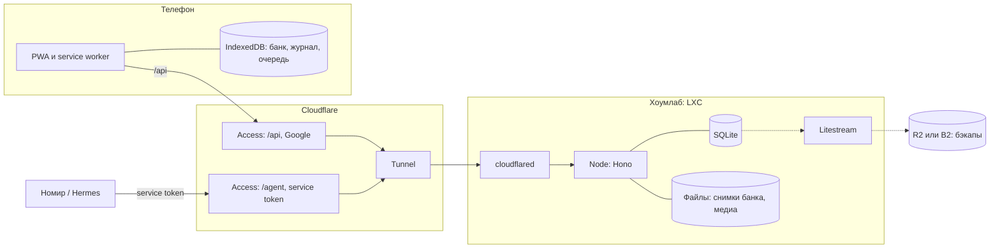

# de-trainer — техническая спецификация

**Версия:** 0.2 · **Дата:** 2026-11-01 · **Основа:** `_source_nomir/PRD-BRD.md` v0.2.

Документ фиксирует архитектуру MVP. Продуктовые требования — в PRD; ссылки вида «§N PRD» и A01–A18 ведут туда. В версии 0.2 сервер переехал с Cloudflare Workers в хоумлаб (LXC-контейнер за Cloudflare Tunnel), а всё приложение живёт на одном хосте `de-class.vta.dev` с разделением по путям.

## 1. Решения

| Тема | Решение |
|---|---|
| Хостинг | LXC-контейнер в хоумлабе; наружу — Cloudflare Tunnel (`cloudflared`), входящих портов нет |
| Адрес | Один хост `de-class.vta.dev`, разделение по путям: `/`, `/auth`, `/api`, `/agent`, `/demo` |
| Вход пользователя | Cloudflare Access через Google (существующая настройка Zero Trust); JWT Access проверяется сервером |
| Доступ Номира | Сервисный токен Access на пути `/agent` |
| Пользователи | Многопользовательская модель; в MVP активен только Дима |
| Хранение | SQLite (WAL) и файлы на диске контейнера; сервер — источник правды; на устройстве полная копия банка и журнала |
| Резервные копии | Litestream непрерывно копирует SQLite в R2 или B2; файлы и выгрузки — ежедневно туда же |
| Журнал | Append-only события; состояние повторения выводится из журнала, не хранится |
| Общая логика | Пакет `core` (TypeScript): схемы, проверка ответа, вывод состояния, сборка тренировки — один код на клиенте, сервере и в тестах |
| Сервер | Node LTS, Hono (`@hono/node-server`), Drizzle + better-sqlite3 |
| Переносимость | База через Drizzle, файлы через интерфейс `BlobStore`. Переезд на VPS — перенос контейнера; на Cloudflare Workers — адаптеры D1 и R2 |
| Схемы | Zod в `core` → JSON Schema и OpenAPI для Номира |
| Клиент | PWA: React + Vite, IndexedDB (Dexie), service worker (Workbox) |
| Демо | Отдельная статическая сборка на пути `/demo/`, без API |

## 2. Хосты и компоненты



| Путь на `de-class.vta.dev` | Что отдаёт | Защита |
|---|---|---|
| `/` | Оболочка PWA владельца (HTML/JS/CSS, manifest, иконки, `sw.js`) | Публичный: в оболочке нет личных данных |
| `/auth/*` | Вход через Access и редирект обратно | Access, Google |
| `/api/*` | API владельца | Access, Google + проверка JWT на сервере |
| `/agent/v1/*` | API Номира | Access с политикой Service Auth, только токены Номира + проверка JWT |
| `/demo/` | Демо-сборка с `demo`-пакетом и медиа | Публичный, без API и серверных данных |
| `/healthz` | `ok` для мониторинга | Публичный |

Туннель ведёт `de-class.vta.dev` на сервер, сервер маршрутизирует по префиксу пути. Access настраивается приложениями по путям: более специфичный путь побеждает. Если существующее wildcard-приложение уже покрывает хост, для `/`, статики, `/demo` и `/healthz` нужно отдельное приложение с политикой Bypass.

**Демо на том же origin.** Браузер не разделяет хранилища демо и владельца, поэтому изоляция логическая:

- демо-сборка не содержит модулей API и синхронизации (проверяется тестом на содержимое бандла);
- базы IndexedDB и кеши с разными префиксами (`owner:{user_id}:…`, `demo:…`); у демо свой service worker со scope `/demo/`, а service worker владельца не обрабатывает `/demo/`, `/api` и `/agent`;
- выход владельца очищает его локальные данные до перехода в демо.

Цена решения: XSS в любой части хоста достаёт и до локальных данных владельца, и до его сессии Access. Поэтому строгий CSP и запрет HTML в контенте (§12) обязательны и для демо.

Почему оболочка вне Access: браузер запрашивает manifest и обновление `sw.js` без cookie Access или после её истечения. Если оболочка за Access, ломаются установка PWA и обновление service worker. Личные данные идут только через `/api`.

## 3. Аутентификация и права

### 3.1. Пользователь

Access на путях `/api` и `/auth`: существующая настройка Zero Trust с Google IdP, политика Allow по списку Google-аккаунтов. Длительность сессии Access — 30 дней.

Сервер на каждом запросе к `/api`:

1. Берёт `Cf-Access-Jwt-Assertion`, проверяет подпись по JWKS команды (`https://<team>.cloudflareaccess.com/cdn-cgi/access/certs`, кешируется), `aud` приложения, `iss` и `exp`.
2. По `email` находит запись в `users`; нужна `status = active`, иначе 403. Получается два замка: политика Access и таблица пользователей.
3. Кладёт `user_id` в контекст. Все репозитории принимают `user_id` обязательным параметром; запросов к пользовательским данным без него в коде нет.

Проверка JWT на сервере — основной замок, а не формальность: даже если кто-то в домашней сети достучится до порта в обход туннеля, без валидного JWT `/api` и `/agent` отвечают отказом.

Вход и повторный вход: `/auth/login` защищён Access и после входа редиректит на `/`. Клиент вызывает API с `redirect: 'manual'`; ответ `opaqueredirect` или 401 означает истёкшую сессию. Тогда показывается баннер «Войти заново», а тренировки продолжаются локально.

### 3.2. Номир

Access-приложение на пути `/agent` с политикой Service Auth. Номир отправляет `CF-Access-Client-Id` и `CF-Access-Client-Secret`; Access пропускает запрос и передаёт JWT, где `common_name` — Client ID токена. Сервер находит запись в `agents` по Client ID и проверяет `agent_grants`:

| Право | Область | Что разрешает |
|---|---|---|
| `events:read` | пользователь | Читать журнал, включая сырые ответы и отметки |
| `events:write` | пользователь | Добавлять события Номира: диагнозы, решения по отметкам, инвалидацию попыток |
| `recommendations:write`, `scheduler:write` | пользователь | Публиковать приоритеты и параметры планировщика в заданных границах |
| `bank:publish` | банк | Загружать медиа, публиковать пакеты, откатывать |

Даже если Hermes работает в той же домашней сети, Номир ходит через `de-class.vta.dev/agent` и Access: права проверяются одинаково, обходного входа нет.

В API Номира пользователь виден только как `user_id`, без email и имени. Отзыв доступа: удалить сервисный токен в Access (действует сразу) или выставить `agents.status = revoked`.

### 3.3. Пользователи и окружения

Новый пользователь: email в политику Access и скрипт `pnpm admin user:add --email … --bank …`. Интерфейса регистрации нет.

В окружениях `dev` и `test` сервер принимает JWT, подписанные тестовым ключом. В `prod` конфигурация с тестовым ключом не стартует: проверка при запуске.

## 4. Репозиторий и стек

```
apps/web          PWA: React, Vite, vite-plugin-pwa (Workbox), Dexie; сборки owner и demo
apps/server       Node + Hono: /api, /auth, /agent/v1, статика owner и /demo, фоновые задачи
packages/core     Zod-схемы, проверка ответа, вывод состояния, сборка тренировки, RNG
packages/fixtures тестовые пакеты owner/demo и журналы для приёмки
scripts           admin (пользователи, агенты, выгрузка, восстановление), deploy
deploy            systemd-юниты, конфиги cloudflared и Litestream, пример env-файла
docs              спецификация, API Номира, инструкция для Димы
```

pnpm workspaces, TypeScript strict, Vitest, Playwright. Миграции — drizzle-kit, применяются при деплое до перезапуска сервиса.

## 5. Модель данных

### 5.1. SQLite

Режим WAL, `foreign_keys = ON`, один процесс-писатель — для MVP этого достаточно.

| Таблица | Ключ | Назначение |
|---|---|---|
| `users` | `user_id` (UUID) | `email` UNIQUE, `display_name`, `status`, `created_at` |
| `banks` | `bank_id` | Банк контента: `title`, `audience` (`owner`/`demo`) |
| `bank_members` | (`bank_id`, `user_id`) | Какие банки доступны пользователю |
| `agents`, `agent_grants` | `agent_id` | Сервисные клиенты (Номир) и их права на пользователей и банки |
| `bank_versions` | (`bank_id`, `version`) | `kind` (`publish`/`rollback`), `package_id`, `package_version`, `content_hash`, `changelog`, `created_by`, `created_at`; UNIQUE(`bank_id`, `package_id`, `package_version`) |
| `bank_heads` | `bank_id` | Текущая версия банка |
| `content_objects` | (`bank_id`, `kind`, `object_id`, `revision`) | Неизменяемые ревизии тем, навыков, элементов знания и упражнений; `body` JSON, `created_version` |
| `media` | (`bank_id`, `media_id`) | `sha256`, `mime`, `bytes`, `width`, `height` |
| `events` | `seq` (autoincrement) | Журнал: `event_id` UNIQUE, `user_id`, `device_id`, `type`, `actor`, `client_ts`, `server_received_at`, `clock_suspect`, `payload` JSON; индекс (`user_id`, `seq`) |
| `recommendations` | (`user_id`, `recommendation_id`) | Приоритеты Номира со сроком действия |
| `scheduler_configs` | (`user_id`, `version`) | Параметры планировщика: кто и когда задал |

### 5.2. Файлы

Каталог данных `DATA_DIR`, доступ через интерфейс `BlobStore`:

- `banks/{bank_id}/v/{version}/manifest.json` — какие ревизии и статусы входят в версию.
- `banks/{bank_id}/v/{version}/snapshot.json` — полный банк версии для клиента и Номира (только `published`).
- `media/{sha256}` — файлы по хешу; сервер отдаёт их с `Cache-Control: immutable`.

Состояние повторения в базе не хранится: это производные данные (§8.3 PRD), их считает функция из `core`.

## 6. Контент

### 6.1. Пакет и публикация

Пакет — изменение банка, а не полный снимок: объекты с ревизиями (темы, навыки, элементы знания, упражнения, ссылки на медиа) плюс явный список `retire`. Неявного снятия нет: объект, которого нет в пакете, остаётся как был. Так ошибка агента не снимет пол-банка.

Публикация, `POST /agent/v1/banks/{bank_id}/packages`:

1. Валидация схемой из `core`: версия схемы, лимиты размера, запрет HTML, только растровые медиа.
2. Проверка против текущей версии банка: ревизия существующего объекта строго больше текущей; та же ревизия с другим содержимым — ошибка; все ссылки на навыки, элементы, темы и медиа разрешаются в итоговом банке; ID снятых объектов не переиспользуются.
3. Идемпотентность: тот же (`package_id`, `package_version`) с тем же `content_hash` возвращает существующую версию, с другим — 409.
4. Запись: снимок и манифест новой версии в файлы, затем одна транзакция SQLite — `content_objects`, `bank_versions`, `bank_heads` и служебные события. Если транзакция не прошла, остаются файлы без ссылок; вреда от них нет.
5. Ответ: номер версии и diff (добавлено, изменено, снято).

`POST /agent/v1/banks/{bank_id}/packages:validate` делает то же без записи: Номир видит ошибки и diff до публикации.

**Исправление ключа.** Ревизия с флагом `key_fix: true` порождает событие `attempts_invalidated` для попыток на прежних ревизиях. Они перестают влиять на оценку (A06), журнал не меняется.

**Откат.** `POST …/rollback {to_version}` создаёт новую версию `kind = rollback` с манифестом целевой версии. История линейна, ничего не удаляется.

**Медиа.** Сначала `PUT /agent/v1/banks/{bank_id}/media/{sha256}` (идемпотентно; проверяются хеш, MIME по сигнатуре файла, размер и габариты), затем пакет ссылается на `media_id`. Ориентир — до ~150 КБ WebP на картинку, чтобы весь банк помещался на телефон.

### 6.2. Форматы и проверка ответа

Набросок типов; финальная схема — в `core`.

```ts
type Stimulus = {
  text?: string                     // простой текст, без HTML
  passage?: { kind: 'text' | 'dialogue'; lines: { speaker?: string; text: string }[] }
  media?: { media_id: string; alt: string }
}

type AnswerSpec =
  | { type: 'choice'; options: { id: string; text: string }[]; correct: string[]; shuffle: boolean }
  | { type: 'gaps'; template: string          // "Ich trage ein{g1} rot{g2} Rock."
      gaps: { id: string; mode: 'input' | 'chips'; options?: { id: string; text: string }[]
              accept: string[]; case: 'sensitive' | 'insensitive'; umlaut_fallback: boolean
              near_miss: 'off' | 'typo1'; knowledge_item_ids: string[] }[] }
  | { type: 'order'; unit: 'word' | 'line'; tiles: { id: string; text: string }[]
      accept: string[][] }                    // допустимые последовательности ID плиток

type CheckResult = {
  outcome: 'correct' | 'near_miss' | 'wrong' | 'skipped' | 'revealed'
  parts?: { gap_id: string; outcome: 'correct' | 'near_miss' | 'wrong' }[]
}
```

Проверка — чистая функция `check(answerSpec, response, checkerVersion)` в `core`:

- Unicode NFC; регистр, пробелы и пунктуация — по политике задания.
- `ä/ö/ü/ß` не заменяются на `ae/oe/ue/ss` без `umlaut_fallback`.
- `near_miss` — одна опечатка вне проверяемой части.
- Варианты и плитки хранятся по ID, поэтому перемешивание не меняет смысл сохранённого ответа.

## 7. Журнал событий

События неизменяемы; `event_id` — UUIDv7, генерируется на устройстве.

| Тип | Кто пишет | Содержимое |
|---|---|---|
| `session_started` | клиент | `session_id`, `bank_version`, режим, `seed`, план заданий |
| `attempt` | клиент | Поля §8.2 PRD, `check_result`, `checker_version` и копия тегов ревизии: `primary_skill_id`, `knowledge_item_ids`, `family_id`, разметка частей |
| `session_finished` | клиент | Итоги сессии |
| `exercise_flagged` | клиент | `exercise_id`, `revision`, комментарий |
| `diagnosis` | Номир | `attempt_ids`, навыки и элементы, пояснение |
| `flag_resolved` | Номир | Ссылка на отметку и решение: `fixed` (ревизия N), `retired` или `rejected` |
| `attempts_invalidated` | сервер при `key_fix`, Номир | `exercise_id`, ревизии, причина |

Сервер проверяет, что `user_id` события совпадает с пользователем из токена, ставит `server_received_at` и помечает `clock_suspect`, если `client_ts` в будущем. Повторный `event_id` игнорируется (`INSERT … ON CONFLICT DO NOTHING`).

Копия тегов в `attempt` нужна, чтобы выводить состояние без старых ревизий на устройстве.

## 8. Повторение и сборка тренировки

Вся логика в `core` и одинаково работает на клиенте и на сервере.

- `deriveState(events, config, schedulerVersion)` сворачивает журнал в состояние по каждому навыку и элементу знания: ступень лестницы, `due_at`, независимые успехи, число разных дней и семейств, свежие ошибки, статус из пяти состояний (§7.3 PRD). События сортируются по (`client_ts`, `event_id`); порядок полный, поэтому результат одинаков на любом устройстве. Пересчёт идёт с нуля при каждом изменении журнала: тысячи событий — миллисекунды.
- На интервал влияют только попытки отложенного повторения без подсказки и показа ответа. Инвалидированные попытки пропускаются. Немедленный повтор не повышает ступень, и одна сессия не повышает её дважды.
- `buildSession(state, bank, recommendations, config, rng)` собирает тренировку по корзинам §7.2 PRD: без дублей, с перераспределением пустых корзин, с лимитами на семейство и тему. Задания с отметкой «спорное» скрыты до `flag_resolved`. RNG инициализируется `seed` из `session_started`, поэтому сессию можно воспроизвести.
- Приоритеты Номира действуют до `expires_at`; без действующих работает запасное правило по свежим ошибкам.

## 9. Офлайн и синхронизация

**На устройстве** (IndexedDB, отдельно для каждого `user_id`):

- снимок банка текущей версии и ревизии, нужные активной сессии;
- весь журнал пользователя и очередь неотправленных событий;
- приоритеты, параметры планировщика, курсор `last_seq`.

Медиа лежат в Cache Storage по `sha256`, оболочка PWA — в precache service worker. При первом входе приложение запрашивает `navigator.storage.persist()`.

**Протокол.** Запускается при открытии приложения, по событию `online` и после каждой сессии:

1. `POST /api/sync/push {events}` → `{accepted, duplicates, max_seq}`. Ответ записывается локально в одной транзакции с удалением событий из очереди.
2. `GET /api/sync/pull?since={last_seq}` → события с других устройств и от Номира, текущая версия банка, ETag приоритетов и конфигурации, а при изменении — их содержимое.
3. Если версия банка новее: `GET /api/banks/{bank_id}/snapshot?version=…`, затем докачка недостающих медиа по хешу. Новый снимок применяется после завершения активной сессии.

Конфликтов нет по построению: события только добавляются, слияние устройств — объединение по `event_id`, состояние пересчитывается.

Если хоумлаб недоступен, приложение этого почти не замечает: тренировки идут локально, синхронизация повторяется позже.

**Выход.** Если очередь не пуста — предупреждение. Затем удаляются IndexedDB, Cache Storage с личными медиа и прочие данные пользователя, и приложение переходит на `/demo/`.

**Обновление приложения.** Новый service worker ждёт: `skipWaiting` только по кнопке «Обновить» или вне активной сессии (A14).

## 10. API

### 10.1. Владелец — `/api`, JWT пользователя

| Метод | Путь | Назначение |
|---|---|---|
| GET | `/api/me` | `user_id`, банки, версии схемы и алгоритма |
| POST | `/api/sync/push` | Отправка событий |
| GET | `/api/sync/pull` | События, версия банка, приоритеты, конфигурация |
| GET | `/api/banks/{bank_id}/snapshot` | Снимок версии банка |
| GET | `/api/media/{sha256}` | Файл медиа, только из банков пользователя |
| GET | `/api/banks/{bank_id}/versions` | История версий и changelog |
| POST | `/api/banks/{bank_id}/rollback` | Откат |
| GET | `/api/export` | Полная выгрузка пользователя (§8.3 PRD) |

### 10.2. Номир — `/agent/v1`, сервисный токен

| Метод | Путь | Назначение |
|---|---|---|
| GET | `/agent/v1/whoami` | Агент и его права — проверка токена и подключения |
| GET | `/agent/v1/users` | Доступные пользователи: `user_id` без email |
| GET | `/agent/v1/users/{user_id}/events?since=&types=` | Журнал с сырыми ответами |
| GET | `/agent/v1/users/{user_id}/state` | Вывод состояния по навыкам и элементам |
| POST | `/agent/v1/users/{user_id}/events` | События Номира: `diagnosis`, `flag_resolved`, `attempts_invalidated` |
| PUT | `/agent/v1/users/{user_id}/recommendations` | Действующий набор приоритетов |
| PUT | `/agent/v1/users/{user_id}/scheduler-config` | Параметры в разрешённых границах |
| GET | `/agent/v1/banks/{bank_id}` | Текущий снимок и история версий |
| PUT | `/agent/v1/banks/{bank_id}/media/{sha256}` | Загрузка медиа |
| POST | `/agent/v1/banks/{bank_id}/packages:validate` | Проверка и diff без записи |
| POST | `/agent/v1/banks/{bank_id}/packages` | Публикация |
| POST | `/agent/v1/banks/{bank_id}/rollback` | Откат |
| GET | `/agent/v1/schema/{name}` | JSON Schema пакета, приоритетов и событий |

OpenAPI генерируется из Zod (`@hono/zod-openapi`) и лежит в `docs/`. Ошибки — JSON с кодом, путём к полю и сообщением, без секретов и стека.

## 11. Демо

Сборка `apps/web` в режиме `demo` отдаётся с `/demo/`: в бандл входят `demo`-пакет и его медиа, модулей синхронизации и API нет — они исключаются при сборке, это проверяется тестом на содержимое бандла. Журнал и состояние гостя — в IndexedDB его браузера под префиксом `demo:`, сброс одной кнопкой. Своего manifest у демо нет, отдельным приложением оно не устанавливается. Изоляция от данных владельца на одном телефоне логическая (§2, A10).

Если хоумлаб недоступен, недоступно и демо.

## 12. Безопасность

- Двойная проверка доступа: Access плюс проверка JWT, `users.status` и `agent_grants` на сервере; по умолчанию — отказ.
- Изоляция пользователей: `user_id` из токена — обязательный параметр каждого запроса к данным; тесты на двух пользователях (A18).
- Контент пакета недоверенный: текст рендерится только как текст (без `dangerouslySetInnerHTML`), строгий CSP (`default-src 'self'`, без inline-скриптов), медиа только растровые с проверкой сигнатуры.
- Обе публичные сборки (owner и demo) проверяются тестом на отсутствие личных данных (A09).
- Сеть: сервер принимает соединения только от коннектора туннеля — на `127.0.0.1`, если `cloudflared` в том же контейнере, иначе firewall контейнера пропускает только хост коннектора. На роутере нет проброшенных портов.
- Контейнер: непривилегированный LXC, отдельный системный пользователь для сервиса, автоматические обновления безопасности (`unattended-upgrades`).
- Секреты (AUD приложений Access, ключи бакета бэкапов) — в env-файле с правами 600, не в репозитории. Токен Номира есть только у Номира.
- Логи (pino → journald): метод, путь, статус, `user_id`, длительность. Тела запросов и ответов и токены не логируются.

## 13. Резервные копии

- **База:** Litestream непрерывно реплицирует SQLite в бакет R2 или B2; снимки хранятся 30 дней.
- **Файлы:** снимки банка и медиа раз в сутки синхронизируются туда же через `rclone sync`; адресация по хешу делает синхронизацию инкрементальной.
- **Переносимая выгрузка:** раз в сутки каждый пользователь выгружается в формате `/api/export` (B6); хранение 90 дней.
- **Снимки контейнера** средствами хоста (например vzdump в Proxmox) — дополнительно, но не вместо копии вне дома.
- **Восстановление:** `litestream restore` и `rclone` для файлов либо admin-скрипт из выгрузки. Проверяется тестом A07 (число и ID событий совпадают, сводка пересчитывается) и одной учебной процедурой на запуске.

Ежедневные задачи — systemd timers.

## 14. Тесты и приёмка

| Уровень | Инструмент | Покрывает |
|---|---|---|
| Unit (`core`) | Vitest | Проверка ответа всех форматов (A02); вывод состояния и сборка тренировки на фиксированных журналах (A03, A04); `key_fix` (A06) |
| Интеграция (`server`) | Vitest; сервер Hono в процессе на временной SQLite и временном каталоге; тестовые JWT | Публикация, идемпотентность, откат (A05); push/pull и два устройства (A11, A12); экспорт и восстановление (A07); права Номира (A09, A16); отметки (A17); изоляция пользователей (A18); ошибки без секретов (A15) |
| E2E | Playwright, viewport 360 px | Тренировка (A01); режим полёта через `setOffline` (A11); owner → выход → демо (A10); демо и сброс (A08); обновление во время сессии (A14); пакет с HTML/JS (A15) |
| Ручной протокол | iOS Safari, Android Chrome | Установка, запуск, офлайн, экранный диктор (A13) |

В интеграционных тестах API не мокается: сервер работает на настоящей SQLite и настоящем каталоге файлов.

## 15. Окружения и деплой

- **`dev`:** `pnpm dev` — сервер с локальной SQLite и тестовым ключом JWT плюс Vite dev server.
- **`prod`:** LXC с systemd-сервисами `de-trainer` (Node), `litestream` и `cloudflared` (если коннектор не общий) и timers для выгрузки и `rclone`.
- **CI** (GitHub Actions или аналог) гоняет линтер, проверку типов и тесты.
- **Деплой — pull из контейнера:** `scripts/deploy.sh <tag>` забирает тег, собирает, применяет миграции, переключает symlink `current` на новый релиз и перезапускает сервис. Предыдущий релиз остаётся для быстрого отката. Миграции только добавляющие, чтобы откат кода не ломал базу.
- **Cloudflare** — маршрут туннеля на `de-class.vta.dev`, Access-приложения по путям и сервисный токен Номира настраиваются в существующем Zero Trust по инструкции из `docs/`.
- **Мониторинг:** публичный `/healthz` (отвечает только `ok`) для проверки доступности, например через Uptime Kuma в хоумлабе.

## 16. План реализации

| Этап | Результат | PRD |
|---|---|---|
| M0 | LXC, туннель, Access-приложения, systemd-юниты, Litestream, deploy-скрипт, каркас монорепо и CI; проверка входа через Access в установленной PWA на iOS | §13.1 |
| M1 | `core`: схемы, JSON Schema, проверка ответа. Публикация пакета через API с валидацией, медиа и версиями. Тестовые пакеты owner и demo | §13.2 |
| M2 | Вертикальный сценарий: вход → скачивание банка → тренировка в трёх форматах → push → Номир читает журнал и публикует приоритеты → следующая тренировка их учитывает | §13.3 |
| M3 | Полный офлайн и pull, вывод состояния по §7.3, отметки «спорное», `key_fix`, откат, экспорт и бэкапы | §13.4 |
| M4 | Демо, усиление безопасности, приёмка A01–A18 с отчётом, документация для Номира и Димы | §13.5 |

## 17. Открытые вопросы и риски

1. Длительность сессии Access: предлагается 30 дней.
2. Границы параметров планировщика, которые Номир может менять.
3. Бакет для бэкапов: R2 (бесплатно до 10 ГБ) или B2.
4. Хоумлаб: гипервизор (Proxmox или другой), где работает Hermes и где стоит существующий коннектор `cloudflared` — в новом контейнере или отдельно (§12).
5. Где хостится репозиторий — оттуда контейнер забирает релизы.
6. Риск: вход через Access из установленной PWA на iOS уводит на Google и домен команды Access и обратно. Нужно убедиться, что cookie попадает в контекст PWA. Проверяется в M0 до остальной работы.
7. Риск: без света или интернета дома синхронизация, публикации Номира и демо ждут, а первый вход с нового устройства невозможен. Тренировки на уже настроенных устройствах продолжаются.
